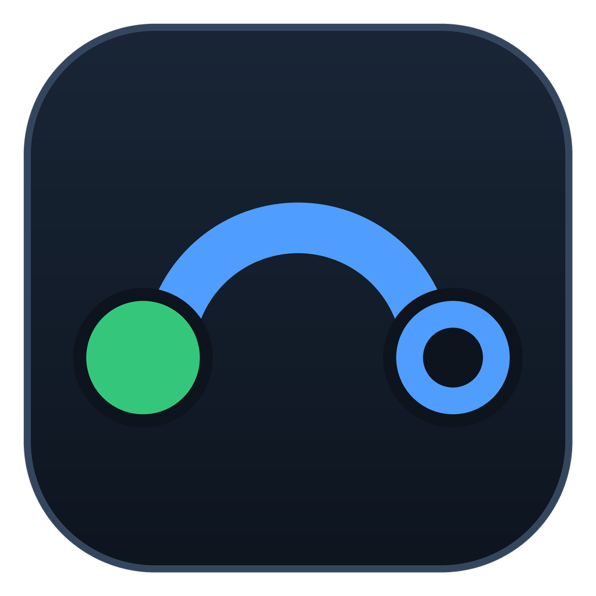
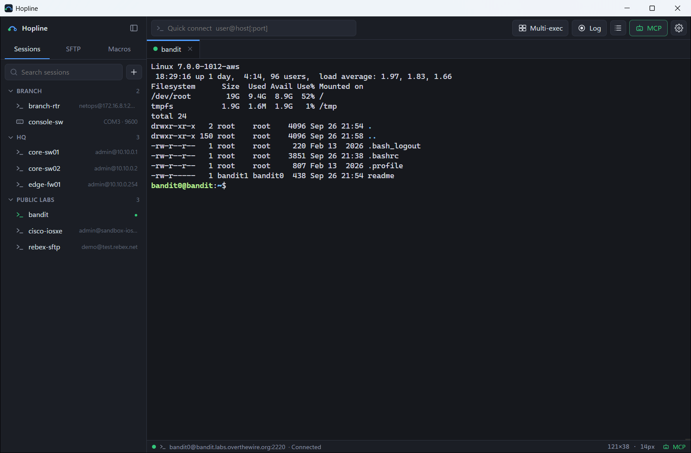
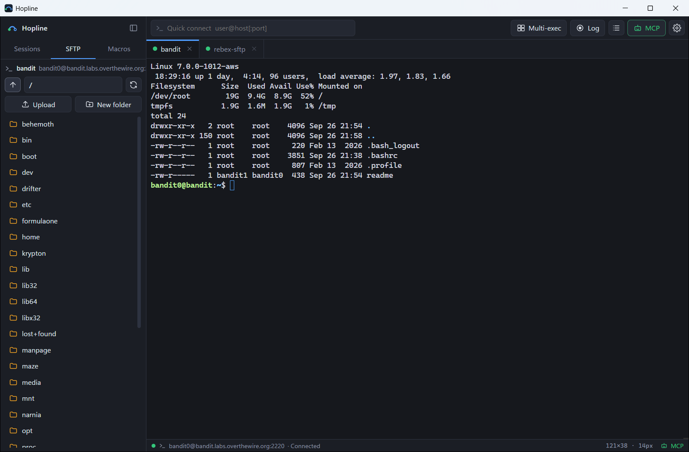
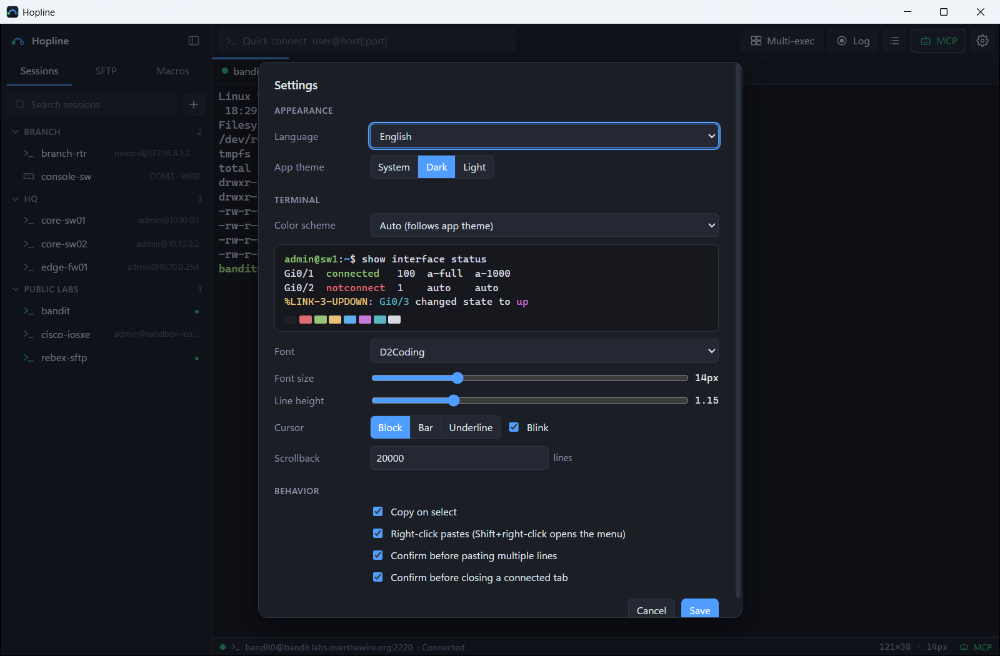
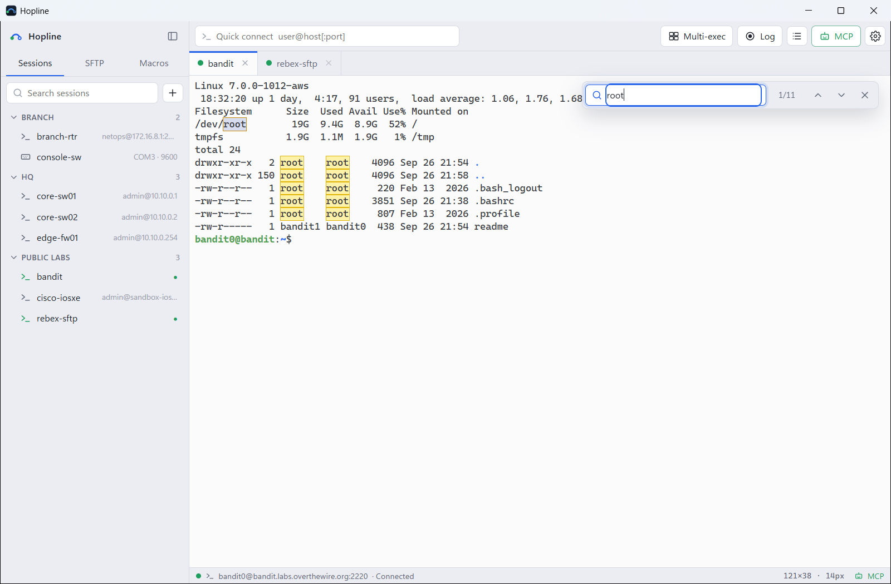
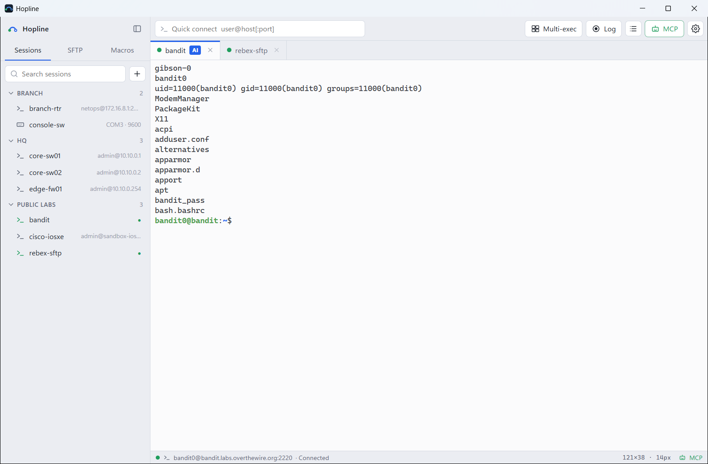

<p align="center">
  
</p>

<h1 align="center">Hopline</h1>

<p align="center">
  Windows용 경량 SSH · SFTP · 시리얼 터미널. MCP 서버가 내장되어 있어 AI 어시스턴트가 내 세션에서 일하는 모습을 그대로 지켜볼 수 있습니다.
</p>

<p align="center">
  <a href="https://github.com/minhyeok2487/Hopline/releases/latest"><b>다운로드</b></a> ·
  <a href="https://hopline-app.vercel.app/ko">웹사이트</a> ·
  <a href="docs/GUIDE.ko.md">사용 가이드</a> ·
  <a href="README.md">English</a> · 한국어
</p>


<p align="center"><a href="docs/media/hopline-promo.mp4">▶ 30초 데모 영상 보기</a></p>

Hopline은 네트워크 엔지니어가 매일 쓰는 터미널 기능(저장된 세션, 탭, SFTP, 시리얼 콘솔, 멀티 실행)만 모아 약 16MB 실행 파일 하나에 담았습니다. Go와 [Wails](https://wails.io)로 만들었고 터미널 화면은 [xterm.js](https://xtermjs.org)로 그립니다.

## 기능



**세션과 터미널**
- SSH·텔넷·시리얼 세션을 폴더(하위 폴더, 끌어서 옮기기, 이름 변경, 모두 접속)로 정리하고 검색하거나 방향키로 고를 수 있음
- 탭 순서 바꾸기, 이름 바꾸기, 복제. 탭 2개·4개를 나란히 보는 화면 나누기. `user@host[:port]`나 `telnet 주소`로 빠른 접속
- MobaXterm, PuTTY, SecureCRT, Xshell 세션 가져오기. 세션·매크로·설정 백업과 복원(비밀번호는 원하면 백업 암호로 암호화해 포함)
- 비밀번호, 개인키, 키보드 인터랙티브 인증. 오래된 스위치·방화벽용 구형 알고리즘 허용 옵션
- 비밀번호는 Windows DPAPI로 암호화되어 내 Windows 계정에서만 복호화됨
- 처음 접속한 서버의 호스트 키를 저장하고, 키가 바뀌면 접속을 막고 지울 위치를 안내함
- 접속 중 화면에서 취소 가능, 연결이 끊기면 재접속 버튼 표시

**파일과 콘솔**
- 현재 탭의 SFTP 패널: 경로 이동, 버튼이나 끌어다 놓기로 업로드, 다운로드, 이름 바꾸기, 삭제, 새 폴더
- 시리얼(COM) 콘솔: 속도, 데이터 비트, 패리티, 정지 비트 설정
- 내장 TFTP 서버: 펌웨어 업그레이드와 설정 백업용, 정한 폴더 안에서만 주고받음

**여러 장비 다루기**
- 멀티 실행: 한 번 입력하면 체크한 모든 탭으로 전송
- 매크로: 명령 묶음을 이름으로 저장해 줄 간격을 두고 한 줄씩 전송, 탭 아래 **명령 버튼 바**에 고정해 한 번에 실행 (`Alt+1`–`9`), `{{변수}}`는 실행할 때 입력, 보내기 전 확인 선택
- 자동 로그온: 접속 후 기다릴 문자열/보낼 내용 단계를 자동 실행 (enable, 콘솔 로그인, 점프 접속), 숨김 값은 암호화 저장
- 자동 업데이트: 새 버전을 알려 주고, 내려받은 파일을 검증한 뒤 새 버전으로 다시 시작
- 창을 닫아도 트레이에서 계속 실행되어 MCP 서버와 연결이 유지됨, Windows 시작 시 자동 실행 선택 가능
- 키워드 강조: 장비 출력의 down/error, up, 경고, IP·MAC, 인터페이스 이름에 색 입히기, 규칙 직접 편집 가능
- 세션 로그: 모든 세션 또는 세션별 자동 기록, 장비별 폴더, 줄마다 시각 표시, 전체 로그 검색이 되는 로그 창

**AI 내장** (설치된 [Claude Code](https://claude.com/claude-code) 사용, API 키 불필요)
- AI 도우미 패널 (`Ctrl+Shift+A`): 현재 탭 화면을 보고 답하고, 제안한 명령은 **입력**/**실행** 버튼으로 바로 보냄. 설정을 바꾸는 명령은 입력만 됨
- 터미널에서 출력을 선택하고 **AI에게 묻기**를 누르면 설명
- 세션 로그 AI 작업 요약: 실행한 명령, 변경 사항, 이상 징후 정리
- 정기 점검: 정해둔 시각에 백그라운드로 접속해 조회 명령을 실행하고 결과를 저장, AI가 이전 결과와 비교

**사용 편의**
- 다크·라이트 테마, 터미널 색 테마 7종, UI 크기(90~150%), 글꼴·크기·줄 간격·커서 설정
- 터미널 찾기(`Ctrl+Shift+F`), 글자 크기 조절(`Ctrl + = / -`), 크기·전송·멀티 실행 상태를 보여주는 상태 표시줄
- 한국어·영어 UI. 기본값은 Windows 언어를 따름

| SFTP 패널 | 설정 |
|---|---|
|  |  |

| 라이트 테마와 찾기 | AI가 MCP로 입력하는 모습 |
|---|---|
|  |  |

## MCP 연동

Hopline은 로컬 [MCP(Model Context Protocol)](https://modelcontextprotocol.io) 서버를 띄워 Claude Code 같은 AI 클라이언트가 저장된 세션을 열고 명령을 실행하게 할 수 있습니다. 모든 작업은 눈에 보이는 탭에서 이뤄지며, 명령을 보내는 동안 해당 탭이 앞으로 나오고 **AI** 표시가 붙습니다.

1. 상단 **MCP** 버튼을 누르고 **Claude Code에 연결**을 누릅니다. Hopline이 서버를 켜고(`127.0.0.1:7781` 전용, 토큰 인증) Claude Code에 등록한 뒤 [`hopline` 스킬](skills/hopline/SKILL.md)을 설치합니다. 스킬은 Claude가 장비에서 안전하게 일하는 순서를 알려 줍니다(열린 탭 먼저 확인, 기본은 조회만, 변경은 승인 후, 결과는 요약 표로).
   - 이 PC에 `claude` 명령이 없으면 **Claude용 설정 문구 복사**를 눌러 Claude Code 채팅에 붙여넣으세요. Claude가 등록과 스킬 저장을 직접 합니다.
   - 직접 하고 싶다면 창에 나오는 `claude mcp add ...` 명령을 실행해도 됩니다.
2. Claude Code에서 새 세션을 엽니다. Hopline을 켜 둔 채 AI에게 요청합니다. 예: *"hopline으로 core-sw01에 접속해서 인터페이스 상태 보여줘. 조회 명령만 실행해."*

| 도구 | 하는 일 |
|---|---|
| `list_sessions`, `list_tabs` | 저장된 세션 / 연결된 탭 목록. 직접 연 탭도 포함되고, 지금 보고 있는 탭은 `(active)`로 표시 |
| `open_session` | 그 세션의 열린 탭이 있으면 재사용, 없으면 새 탭을 열고 접속(`new: true`면 항상 새 탭) |
| `run_command` | 명령을 보내고 출력을 반환. 프롬프트 감지, `expect` 정규식, `--More--` 자동 넘김 |
| `send_keys`, `read_output` | 대화형 입력(Ctrl+C, y/n) / 현재 화면 읽기 |
| `sftp_list`, `sftp_read_file`, `sftp_write_file`, `sftp_download`, `sftp_upload` | 탭의 SSH 연결을 이용한 파일 작업 |
| `run_on_tabs` | 여러 탭이나 저장된 세션에 같은 명령을 동시에 실행하고 결과를 장비별로 반환 |
| `close_tab` | 탭 연결 끊고 닫기 |

모든 탭 도구는 `tab: "active"`도 받으므로, 직접 접속해 둔 뒤 *"지금 보고 있는 탭에서 show version 실행해줘"*처럼 말하면 됩니다.

저장된 비밀번호는 MCP로 전달되지 않습니다. 비밀번호가 저장되지 않은 세션은 Hopline 창에서 사용자에게 직접 물어보고, 그동안 AI는 기다립니다.

## 다운로드

[최신 릴리스](https://github.com/minhyeok2487/Hopline/releases/latest)에서 `Hopline-<버전>.zip`(예: `Hopline-0.9.1.zip`)을 받아 원하는 폴더에 압축을 풀고 `Hopline.exe`를 실행하면 됩니다. 설치 과정은 없습니다. 회사 보안으로 `.exe` 다운로드가 막히는 경우를 위해 zip으로 배포하며, `.exe`도 함께 올립니다(이전 버전의 자동 업데이트용). Windows 10/11에서 WebView2 런타임(Windows 11 기본 포함)으로 동작합니다.

아직 코드 서명이 없어서 처음 실행할 때 SmartScreen 경고가 뜰 수 있습니다. **추가 정보 → 실행**을 누르세요. 릴리스 노트에 SHA-256 값이 있어 받은 파일을 확인할 수 있습니다.

[Scoop](https://scoop.sh)을 쓰면 명령 한 줄로 설치하고 업데이트할 수 있습니다.

```bash
scoop install https://raw.githubusercontent.com/minhyeok2487/Hopline/main/bucket/hopline.json
```

처음 쓰신다면 [사용 가이드](docs/GUIDE.ko.md)를 참고하세요. 세션, SFTP, 시리얼, 멀티 실행, 매크로, MCP 설정, 문제 해결을 다룹니다.

## 소스로 빌드

Go 1.25 이상, Node.js 20 이상, Wails v2 CLI가 필요합니다.

```bash
go install github.com/wailsapp/wails/v2/cmd/wails@latest
```

```bash
wails build
```

실행 파일은 `build/bin/Hopline.exe`에 만들어집니다. 개발 중에는 `wails dev`로 실시간 반영 빌드를 쓸 수 있습니다.

## 보안 구조

AI가 실제 장비에 입력하는 도구라서 기본값을 보수적으로 잡았습니다.

- **저장된 비밀번호는 AI에 전달되지 않습니다.** 세션은 Hopline에 저장된 접속 정보(Windows DPAPI 암호화)로 연결되고, 비밀번호가 없으면 Hopline 창에서 *사용자에게* 직접 묻습니다.
- **로컬 전용, 토큰 인증.** MCP 서버는 직접 켜기 전에는 꺼져 있고, `127.0.0.1`에서만 열리며, 토큰 없는 요청과 DNS 리바인딩을 막습니다. 토큰을 재발급하면 기존 토큰은 바로 무효가 됩니다.
- **모든 동작이 화면에 보입니다.** AI 명령은 일반 탭에서 실행되고 탭이 앞으로 나오며 **AI** 표시가 붙습니다. 언제든 직접 입력하거나 Ctrl+C를 누르거나 탭을 닫을 수 있습니다.
- **호스트 키를 고정합니다.** SSH 호스트 키가 바뀌면 그냥 넘어가지 않고 접속을 막습니다.
- **최소 권한은 여전히 중요합니다.** AI에게는 필요한 권한만 가진 장비 계정을 주고, 조회만 원할 때는 "조회 명령만"이라고 분명히 말하세요.

## 데이터 위치

| 항목 | 위치 |
|---|---|
| 세션, 매크로, 설정 | `%APPDATA%\Hopline\data.json` |
| 호스트 키 | `%APPDATA%\Hopline\known_hosts` |
| 세션 로그 | `문서\Hopline\logs\<세션>\` (설정에서 변경 가능) |
| 정기 점검 결과 | `문서\Hopline\logs\_checks\<점검>\<실행 시각>\` |

## 단축키

| 키 | 동작 |
|---|---|
| `Ctrl+Tab` / `Ctrl+Shift+Tab` | 다음 / 이전 탭 |
| `Ctrl+Shift+F` | 터미널에서 찾기 |
| `Ctrl + =` / `Ctrl + -` / `Ctrl+0` | 글자 크게 / 작게 / 기본값 |
| `Ctrl+Shift+B` | 사이드바 보이기·숨기기 |
| `Ctrl+Shift+A` | AI 도우미 패널 |
| `Alt+1` … `Alt+9` | 명령 버튼 바 실행 |
| `Ctrl+,` | 설정 |
| 드래그 / 우클릭 | 복사 / 붙여넣기 (Shift+우클릭은 메뉴) |

## 소스 구조

| 경로 | 역할 |
|---|---|
| `app.go` | 연결 관리, 터미널 입출력 이벤트, 매크로 |
| `logs.go` | 세션 로그 기록, 목록, 검색 |
| `ai.go`, `checks.go` | Claude Code CLI를 쓰는 AI 도우미, 정기 점검 |
| `ssh.go`, `sftp.go`, `serial.go` | SSH 세션과 호스트 키, SFTP, 시리얼 포트 |
| `mcp.go`, `outtap.go` | MCP 서버와 도구, 출력 캡처 |
| `store.go`, `dpapi_windows.go` | 세션 저장, 비밀번호 암호화 |
| `i18n.go`, `frontend/src/i18n.js` | 영어·한국어 메시지 |
| `frontend/src/` | UI (바닐라 JS, xterm.js) |

## 라이선스

[MIT](LICENSE)
