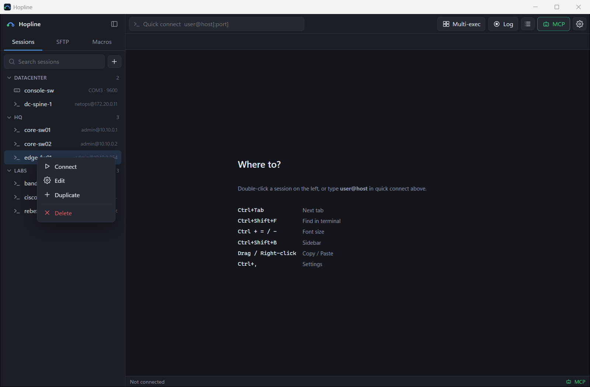
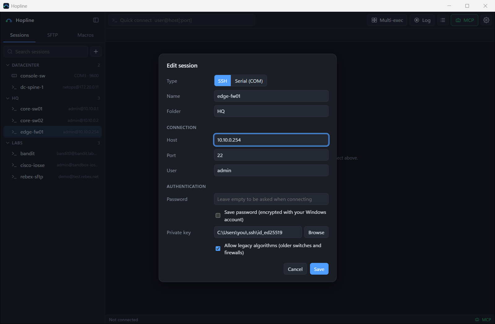
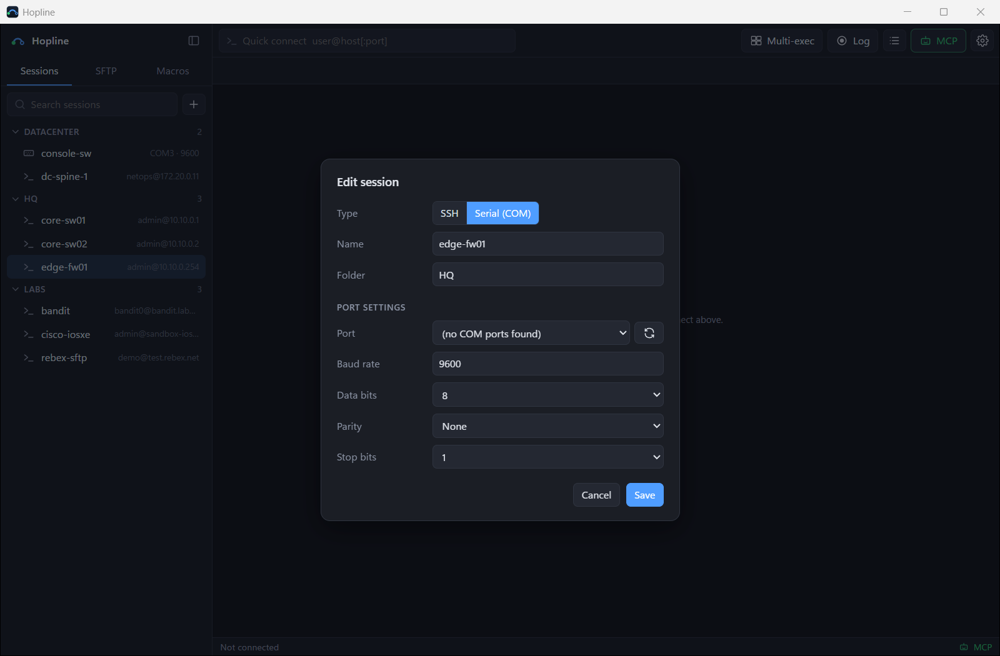
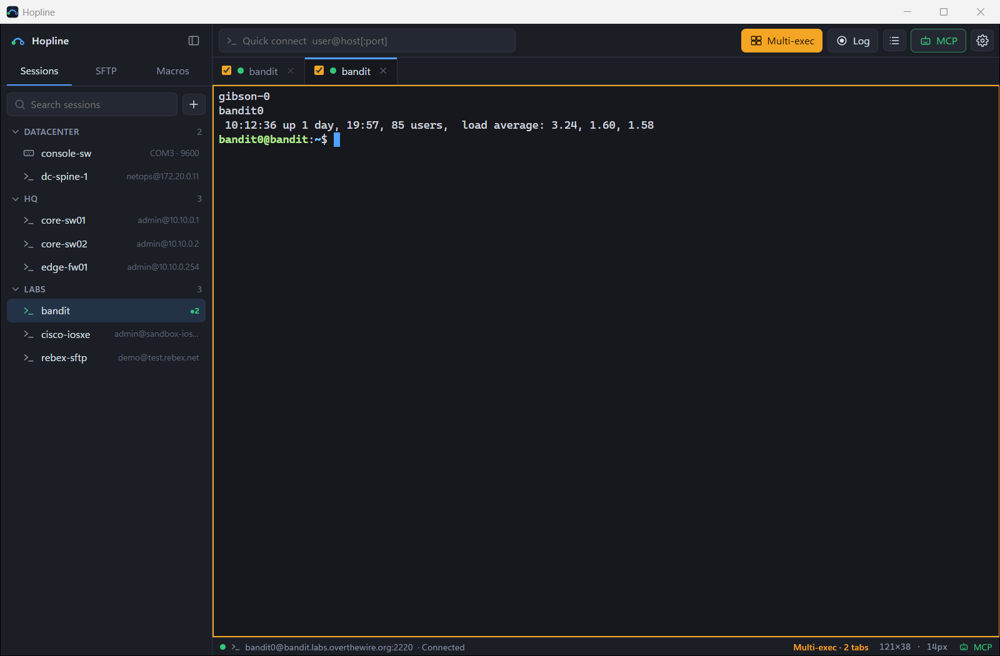
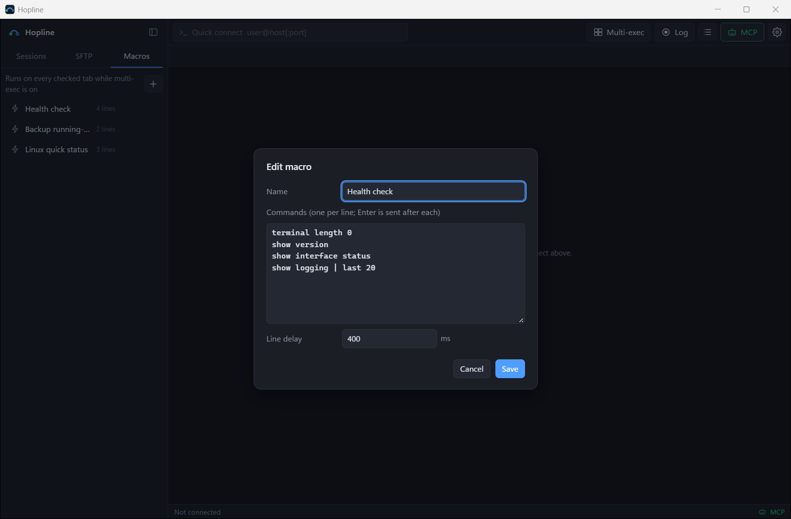

# Hopline user guide

English · [한국어](GUIDE.ko.md) · [Back to README](../README.md)

This guide walks through everyday use of Hopline: installing it, saving sessions, working in the terminal, moving files, serial consoles, running commands on many devices, and letting an AI assistant work through MCP.

- [Install](#install)
- [Connect for the first time](#connect-for-the-first-time)
- [Save and organize sessions](#save-and-organize-sessions)
- [Authentication and host keys](#authentication-and-host-keys)
- [Working in the terminal](#working-in-the-terminal)
- [SFTP file panel](#sftp-file-panel)
- [Serial console](#serial-console)
- [Logon actions (enable, jump hosts)](#logon-actions-enable-jump-hosts)
- [Multi-exec and macros](#multi-exec-and-macros)
- [Session logs](#session-logs)
- [Settings](#settings)
- [AI assistants (MCP)](#ai-assistants-mcp)
- [Troubleshooting](#troubleshooting)

## Install

1. Download `Hopline.exe` from the [latest release](https://github.com/minhyeok2487/Hopline/releases/latest).
2. Put it anywhere (for example `C:\Tools\Hopline\`) and run it. There is no installer.
3. The executable is not code-signed yet, so Windows SmartScreen may say *"Windows protected your PC"*. Click **More info → Run anyway**. You can compare the file's SHA-256 with the value on the release page first.

Hopline needs the Microsoft Edge WebView2 runtime. It is built into Windows 11 and most up-to-date Windows 10 installs; if the app does not start, install the [WebView2 Evergreen runtime](https://developer.microsoft.com/microsoft-edge/webview2/).

To uninstall, delete `Hopline.exe` and, if you want to remove your data too, the folders listed in [Where data is stored](../README.md#where-data-is-stored).

## Connect for the first time

The fastest way is **quick connect** at the top of the window:

1. Type `user@host` or `user@host:port` and press **Enter**.
2. Enter the password when asked. Quick-connect sessions are not saved.

While Hopline connects, the tab shows a **Connecting** card with the elapsed time and a **Cancel** button, so an unreachable device never freezes the window. When a connection drops, a bar at the bottom of the tab offers **Reconnect** (or press **Enter**) and **Close tab**.

## Save and organize sessions

Click **+** in the Sessions panel to create a session, or right-click an existing one for **Connect, Edit, Duplicate, Delete**.





| Field | Notes |
|---|---|
| Name | Shown in the list and on the tab. Defaults to the host. |
| Folder | Type a new name or pick an existing one. Folders collapse in the list. |
| Host, Port, User | Port defaults to 22. |
| Password | Leave empty to be asked on every connect. With **Save password** checked, it is stored encrypted (see below). |
| Private key | Optional path to an OpenSSH or PEM key (`id_ed25519`, `id_rsa`, …). PuTTY `.ppk` files must be converted first. |
| Allow legacy algorithms | Enables older key exchanges and ciphers (for example `diffie-hellman-group1-sha1`, CBC ciphers) that old switches and firewalls still require. Leave it off for modern hosts. |

Tips:
- Double-click a session or select it and press **Enter** to connect; **F2** edits it.
- Type in **Search sessions** to filter by name, host, user or folder. Arrow keys move through the results.
- A green dot next to a session means it has an open tab (`●2` = two tabs).
- The empty screen lists your **recent** connections for one-click reconnects.

## Authentication and host keys

**Saved passwords** are encrypted with Windows DPAPI under your Windows account and stored in `%APPDATA%\Hopline\data.json`. Another Windows user, or another PC, cannot decrypt them.

**Private keys with a passphrase:** Hopline asks for the passphrase in the password prompt when it connects.

**Host keys (trust on first use):** the first time you connect to a host, its key is saved to `%APPDATA%\Hopline\known_hosts` and the fingerprint is printed in yellow in the terminal. If the key later changes, Hopline refuses to connect and shows:

```
The host key has changed! (SHA256:...)
This could be a man-in-the-middle attack. If the device was reinstalled, remove its line from:
C:\Users\<you>\AppData\Roaming\Hopline\known_hosts
```

If you know why the key changed (the device was replaced or reinstalled), open that file, delete the line that starts with the host name or `[host]:port`, and connect again.

## Working in the terminal

| Action | How |
|---|---|
| Copy | Select text with the mouse (copied automatically), or **Ctrl+Shift+C** |
| Paste | Right-click, or **Ctrl+Shift+V**. Pasting several lines asks for confirmation first, because each line can run as a command. |
| Context menu | **Shift + right-click** (copy, paste, select all, find, clear screen) |
| Find | **Ctrl+Shift+F**, then **Enter** / **Shift+Enter** for next and previous, **Esc** to close |
| Font size | **Ctrl + =**, **Ctrl + -**, **Ctrl+0** to reset |
| Switch tabs | **Ctrl+Tab**, **Ctrl+Shift+Tab** |
| Rename a tab | Double-click its title |
| Reorder tabs | Drag a tab |
| Close a tab | **✕**, middle-click, or the tab's right-click menu. A connected tab asks first (can be turned off in Settings). |
| Duplicate / reconnect | Tab right-click menu |
| Sidebar | **Ctrl+Shift+B** hides or shows it; drag its edge to resize, double-click the edge to reset |

The status bar shows the active connection, terminal size, transfers in progress, multi-exec state and whether the MCP server is running.

## SFTP file panel

Open the **SFTP** tab in the sidebar. It shows the files of the **active SSH tab** using that tab's existing connection; nothing else to log in to.


- **Navigate:** double-click a folder, use **↑** for the parent folder, click a part of the path, or click empty space in the path bar to type a path.
- **Download:** double-click a file (or right-click → Download) and choose where to save it.
- **Upload:** click **Upload**, or drag files or whole folders from Explorer onto the file list. Progress appears below the list and in the status bar.
- **Right-click a file or folder** for Rename, Copy path and Delete. Folders can only be deleted when empty, to avoid accidental recursive deletes.

If the panel says SFTP is unavailable, the server does not provide the SFTP subsystem (common on network devices).

## Serial console

Create a session with **Type: Serial (COM)**:



- **Port** lists the COM ports Windows currently sees, with the adapter name when available. Click the refresh button after plugging in a USB console cable.
- Common console settings are **9600 8N1** (Cisco and most switches) or **115200 8N1**.
- If the port is not listed, install the driver for your USB-serial adapter (FTDI, Prolific, Silicon Labs CP210x) and check Device Manager.

## Logon actions (enable, jump hosts)

In the session editor, **Logon actions** holds *expect → send* steps that Hopline types for you every time the session connects. They work for SSH and serial sessions.

- When the **Expect** text appears, Hopline types **Send** and presses Enter. An empty Expect sends right away.
- Values marked **Hide** (passwords) are encrypted with your Windows account, are not shown again in the editor, and are never passed to AI assistants.
- **Send Enter first** wakes a serial console that waits silently.
- If a step's text does not appear within 30 seconds, Hopline stops and tells you which step in the terminal and in a notification.

| Use | Expect | Send | Hide |
|---|---|---|---|
| Enable mode | `>` | `enable` | |
| | `assword:` | enable password | ✓ |
| Serial console login (with Send Enter first) | `sername:` | `admin` | |
| | `assword:` | password | ✓ |
| Hop through a jump host | `$ ` | `ssh admin@10.0.0.2` | |
| | `assword:` | device password | ✓ |

**Add enable example** inserts the two enable steps; just fill in the password. Matching is case-sensitive, so `assword:` catches both `Password:` and `password:`.

## Multi-exec and macros

**Multi-exec** sends what you type to every checked tab at once, for example to run the same `show` command on several switches.



1. Open the tabs you want and click **Multi-exec** in the toolbar. An orange frame shows it is on.
2. Each tab gets a checkbox; uncheck tabs that should not receive input.
3. Type in any checked tab. The status bar shows how many tabs are targeted.

**Macros** are named command lists sent line by line, with **Enter** after each line and a delay in between.



- Create one with **+** in the **Macros** panel; double-click a macro to edit it.
- Click **Run** to send it to the active tab, or to every checked tab while multi-exec is on.
- For network devices, start with a pager-off line such as `terminal length 0` so long output is not interrupted by `--More--`.
- Raise the line delay for slow devices or commands that take a moment to return the prompt.

## Session logs

Click **Log** in the toolbar to start recording the active tab; the tab shows a red **REC** badge. Click again to stop.

Logs are saved as plain text with color codes removed, to `Documents\Hopline\logs\<session>_<date>_<time>.log`. The folder button next to **Log** opens that folder.

## Settings

Open with the gear button or **Ctrl+,**. Changes preview immediately; **Cancel** reverts them.


| Setting | What it does |
|---|---|
| Language | Auto (follows Windows), 한국어 or English |
| UI size | Scales the sidebar, toolbar and dialogs (90–150%). Terminal text uses **Font size**. |
| App theme | System, Dark or Light |
| Color scheme | Terminal colors: Auto (follows the app theme), Hopline Dark, One Light, Dracula, Solarized Dark, Gruvbox Dark, Nord, Campbell |
| Font, Font size, Line height | Terminal text. Monospace fonts with Korean fallback are recommended (D2Coding, Cascadia Mono). |
| Cursor, Blink | Block, bar or underline cursor |
| Scrollback | Lines kept per tab |
| Copy on select | Copy as soon as you select text |
| Right-click pastes | Off: right-click opens the menu instead |
| Confirm multi-line paste, Confirm closing a connected tab | Safety prompts |
| Closing the window hides it to the tray | On by default. See [Keep running in the tray](#keep-running-in-the-tray). |
| Start in the tray when Windows starts | Launches Hopline hidden at sign-in so the MCP server is always available |

## AI assistants (MCP)

Hopline can run a local MCP server so an AI assistant such as Claude Code can open your saved sessions as tabs, run commands and read the output, while you watch.


**Set up**

1. Click **MCP** in the toolbar and press **Connect to Claude Code**. Hopline turns the server on (it listens on `127.0.0.1:7781` only and requires a token), registers it with Claude Code and installs the `hopline` skill to `~/.claude/skills/hopline`.
   - If the `claude` command isn't installed on this PC, press **Copy setup prompt for Claude** and paste it into a Claude Code chat. Claude registers the server and saves the skill for you.
   - To do it by hand, check **Enable MCP server**, then run the command from **Copy command** once in a terminal:

     ```bash
     claude mcp add --scope user --transport http hopline http://127.0.0.1:7781/mcp --header "Authorization: Bearer <token>"
     ```

2. Keep Hopline running. Start a new Claude Code session and ask, for example:
   - *"Use hopline to open core-sw01 and show the interface status."*
   - *"With hopline, check disk usage on every Linux server in the Lab folder. Read-only commands only."*

**The hopline skill** tells Claude how to work on devices through Hopline: check your open tabs first, identify the platform, stay read-only unless you ask for a change, show the exact commands and wait for your approval before changing anything, and finish with a short summary table. Hopline updates the installed skill when Hopline itself is updated; delete the `Installed by Hopline` line in the file to keep your own edits.

**Tabs you already opened:** you don't have to let the assistant connect. Open a session yourself (and log in on a serial console), then ask *"run `show ip interface brief` in my current tab"*. `list_tabs` shows every connected tab with `(active)` on the one in front, all tab tools accept `tab: "active"`, and `open_session` reuses an open tab of the same session instead of opening a duplicate.

**What you will see:** the tab the assistant uses comes to the front and shows an **AI** badge while it types. If a session has no saved password, Hopline asks **you** for it in its own window; the assistant never receives saved passwords.

**Tools:** `list_sessions`, `list_tabs`, `open_session`, `run_command`, `send_keys`, `read_output`, `sftp_list`, `sftp_read_file`, `sftp_write_file`, `sftp_download`, `sftp_upload`, `close_tab`. `run_command` waits for the prompt (or an `expect` pattern, up to 600 s) and answers `--More--` pagers automatically.

**Staying safe**
- Tell the assistant explicitly when only read-only commands are allowed, and review what it plans before approving tool calls.
- Use device accounts with the least privilege you need.
- **New token** in the MCP dialog invalidates the old token immediately; register the new command in Claude Code afterwards.
- Turning the MCP server off closes the port.

### Keep running in the tray

Closing the window does not quit Hopline: it hides to the notification area (system tray), and the MCP server and open connections keep running, so an assistant can keep working with the window closed.

- Click the tray icon, or run `Hopline.exe` again, to bring the window back with its tabs. Only one Hopline runs at a time.
- Right-click the tray icon and choose **Quit** to exit for real.
- If an assistant opens a session with no saved password while the window is hidden, the window comes back and asks you.
- On Windows 11 a new tray icon starts in the hidden icons (**^**); drag it onto the taskbar to keep it visible.
- Settings › Window: turn off **Closing the window hides it to the tray** to make the close button quit, or turn on **Start in the tray when Windows starts**.

## Troubleshooting

| Problem | What to do |
|---|---|
| *"Windows protected your PC"* on first run | The executable is not code-signed. Click **More info → Run anyway**, after checking the SHA-256 on the release page if you like. |
| The window stays blank or the app does not start | Install the WebView2 Evergreen runtime. |
| *The host key has changed!* | See [Authentication and host keys](#authentication-and-host-keys). |
| Old switch or firewall: *no common algorithm* / handshake failed | Edit the session and turn on **Allow legacy algorithms**. |
| *Authentication failed* | Hopline asks for the password again. Check the user name; for key auth, check the key path and that the key is in OpenSSH/PEM format. |
| SFTP panel: *SFTP unavailable* | The server does not offer the SFTP subsystem. Use the terminal or a host that supports SFTP. |
| COM port not listed | Install the USB-serial driver, replug the cable, click refresh in the session editor. |
| Claude Code cannot reach hopline (*connection refused*) | Hopline must be running with the MCP server on. Check the port in the MCP dialog matches the registered URL. |
| Claude Code gets *401 Unauthorized* | The token changed. Copy the command from the MCP dialog again and re-register (`claude mcp remove hopline -s user`, then add). |
| Pasting asks for confirmation every time | Turn off **Confirm multi-line paste** in Settings. |
